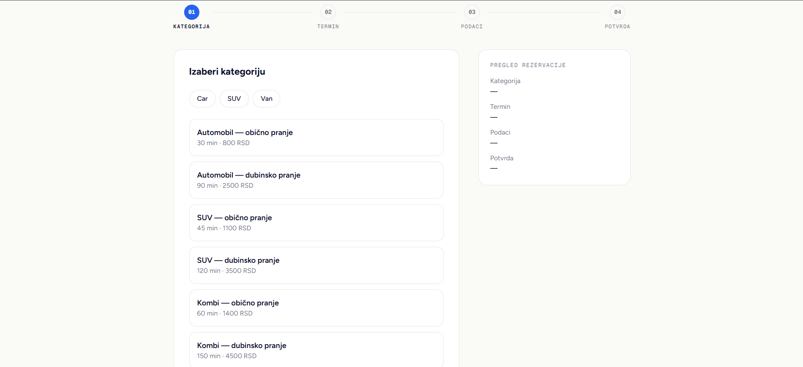
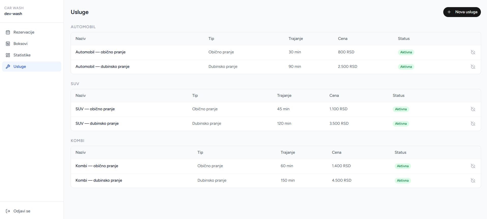
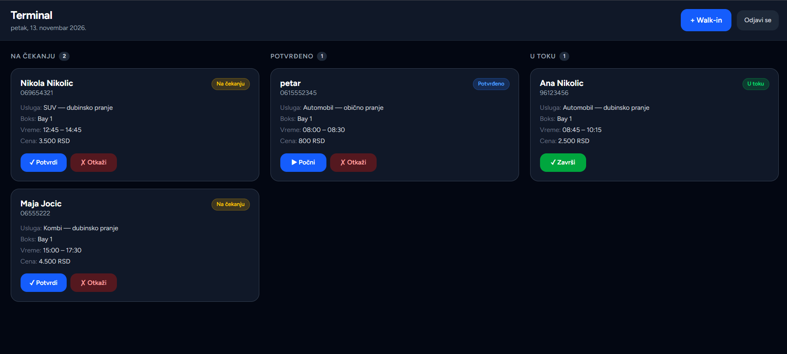
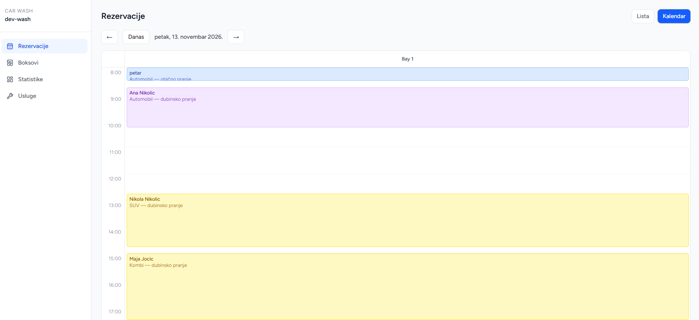

# WashBookPro

Multi-tenant SaaS za vlasnike autoperionica u Srbiji: rezervacije, terminal za
radnike i kontrola nad pranjima i novcem. Svaka perionica dobija svoju javnu
stranicu za zakazivanje, a vlasnik plaća mesečnu pretplatu po lokaciji.

Glavna razlika u odnosu na postojeće alate je **ANPR** (prepoznavanje
tablica): kamera na ulazu beleži vozila, a sistem ih upoređuje sa unetim
pranjima. Tako vlasnik vidi pranja koja radnici nisu evidentirali.

> **Status:** u razvoju, nije u produkciji. Faza A (pilot-ready) traje do
> kraja 2026, a pilot u jednoj perionici je planiran za januar 2027.

| Javna stranica za zakazivanje | Dashboard vlasnika: usluge i cene |
| --- | --- |
|  |  |

| Terminal za radnika | Kalendar rezervacija |
| --- | --- |
|  |  |

## Šta postoji danas

- **Javno zakazivanje** (`/book/[slug]`): mušterija bira uslugu i slobodan
  termin, dobija HTML potvrdu mejlom (Resend).
- **Terminal za radnika** (`/terminal/[slug]`): lista rezervacija za dan,
  promena statusa, unos walk-in pranja.
- **Dashboard vlasnika**: rezervacije, kalendar, boksovi, usluge i statistika.
- **Nalozi mušterija**: registracija, prijava i profil, odvojeni od naloga
  vlasnika i radnika (ADR-022).
- **Algoritam dostupnosti termina** koji uzima u obzir boksove, trajanje
  usluga i postojeće rezervacije.
- **Rate limiting** na javnim endpointima, health check, Serilog + Seq i
  Sentry za praćenje grešaka.

## Tehnologije

| Sloj           | Tehnologija                                                |
| -------------- | ---------------------------------------------------------- |
| Backend API    | ASP.NET Core 10 (C#), EF Core, modularni monolit           |
| Baza           | PostgreSQL 16                                              |
| Web            | Next.js 16, React 19, TypeScript, Tailwind v4, shadcn/ui   |
| Testovi        | xUnit v3 + Testcontainers (prava PostgreSQL baza u testu)  |
| Infrastruktura | Docker Compose, Caddy, GitHub Actions CI                   |
| Servisi        | Resend (email), Sentry (greške), PlateRecognizer (ANPR)    |
| Mobilna app    | React Native + Expo (skeleton, odloženo)                   |

## Arhitektura

- **Modularni monolit**: jedan deployment, backend podeljen po domenima
  (`Auth`, `Customers`, `Reservations`, `Tenants`; `Anpr`, `Billing` i
  `Notifications` za kasnije faze). Detalji u
  [`docs/ARCHITECTURE.md`](docs/ARCHITECTURE.md).
- **Multi-tenancy**: deljena baza sa kolonom `TenantId`, EF Core global
  query filteri i `ITenantScoped` marker. Tenant se za prijavljene korisnike
  čita iz JWT-a, a za javne stranice iz sluga.
- **Testovi**: 50 integracionih testova nad pravom PostgreSQL bazom
  (dostupnost termina, rezervacije i walk-in, bootstrap tenanta, rate limit,
  CORS). CI ih pokreće na svaki push.

## Odluke i plan

Svaka značajna odluka je zapisana kao ADR, sa razlozima i odbačenim
alternativama: [`docs/decisions/`](docs/decisions/) (ADR-001 do ADR-030).
Nekoliko primera:

- [ADR-004](docs/decisions/ADR-004-ef-core-multi-tenant-approach.md): pristup multi-tenancy u EF Core
- [ADR-014](docs/decisions/ADR-014-reservation-status-machine.md): status mašina rezervacije
- [ADR-022](docs/decisions/ADR-022-razdvojeni-auth-sistemi.md): odvojeni auth za mušterije i osoblje
- [ADR-027](docs/decisions/ADR-027-test-strategija.md): strategija testiranja
- [ADR-029](docs/decisions/ADR-029-strateski-fokus.md): strateški fokus na alat za perionice

Plan razvoja po fazama i plan testiranja pilota su u [`docs/plan/`](docs/plan/).

## Razvoj uz AI agente

Projekat se razvija uz Claude Code u orkestrator–agent toku (`.claude/`):
glavna sesija planira i delegira, a odvojeni agenti rade backend, frontend,
testove i code review. Posle svakog koraka hook automatski pokreće build i
testove, a korak prolazi tek kad su testovi zeleni i reviewer ga odobri.
Pravila rada su u [`CLAUDE.md`](CLAUDE.md).

## Pokretanje lokalno

Preduslovi: Docker Desktop, Node.js 20+ i pnpm, .NET SDK 10.

```bash
cd infra
cp .env.example .env   # popuni vrednosti
docker compose up --build -d
```

| Servis      | Adresa                            |
| ----------- | --------------------------------- |
| Web         | http://localhost:3000             |
| API (Scalar)| http://localhost:8080/scalar/v1   |
| pgAdmin     | http://localhost:5050             |
| Seq (logovi)| http://localhost:5380             |

U Development okruženju se pri startu automatski kreira probna perionica
(slug `dev-wash`) sa vlasnikom `owner@devwash.local` / `Owner123!` i radnikom
`worker@devwash.local` / `Worker123!`. Ovi nalozi postoje samo lokalno.

## Autor

Petar Bogdanović, FON (Upravljanje projektima i investicijama).

## Licenca

Sva prava zadržana. Kod je javan radi uvida, ali nije dozvoljeno korišćenje
bez pisane dozvole autora. Detalji u [`LICENSE`](LICENSE).
