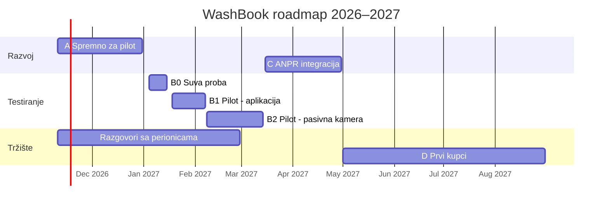

# WashBook — Plan razvoja i roadmap

**Verzija:** 1.0 · **Datum:** 9. novembar 2026 · **Status:** usvojeno
**Prateći dokument:** `WashBook-Plan-testiranja.md`

---

## 1. Zašto ovaj dokument

WashBook je pokušavao da bude četiri stvari odjednom: marketplace za vozače, SaaS za perionice, B2B portal za flote i ANPR sistem protiv krađe. Rezultat je bio preveliki obim, gomilanje tehničkog duga i nejasan prioritet.

Ovaj plan sužava fokus na **jednu stvar za narednih 12 meseci** i zamenjuje „Roadmap Phases“ sekciju u `CLAUDE.md`. Sve što nije u ovom dokumentu je **odloženo** dok se ne donese nova odluka.

---

## 2. Strateška odluka

| Pitanje | Odluka |
| --- | --- |
| Šta je WashBook u 2027? | Alat za vlasnike perionica: evidencija pranja, radnici, rezervacije, kontrola novca |
| Ko plaća? | Vlasnik perionice, mesečna pretplata po lokaciji |
| Glavna poruka | **„Znaš tačno koliko je oprano i koliko je naplaćeno, bez krađe.“** |
| Kako vozači zakazuju? | Preko javne stranice svake perionice (`/book/[slug]`), ne preko marketplace-a |
| Marketplace za vozače | Tek kad bude 20–30 aktivnih perionica |
| ANPR (kamere) | Posle prvog dela pilota: prvo pasivni test, zatim integracija. Prodaje se kao premium paket |
| Cilj za 12 meseci | Prihod: perionice koje plaćaju pretplatu |
| Vreme | 20–40 sati nedeljno |

### Problemi koje rešavamo (po važnosti)

1. **Krađa radnika:** pranja koja nisu evidentirana i novac koji ne stigne u kasu.
2. **Nema pregleda:** vlasnik ne zna koliko je oprano i ko je šta radio.
3. **Gužve i čekanje:** nema rasporeda, pa kupci odlaze.

### Javna stranica po perionici

Postoji **jedna** stranica u kodu (`/book/[slug]`). Svaka perionica dobija svoj slug i link (npr. `app.washbook.tech/book/peric-nis`), a stranica učitava podatke te perionice: naziv, usluge, cene, radno vreme i termine. Nova perionica znači novog tenanta, ne novi kod. Marketplace će kasnije biti nova stranica **iznad** ovih (`/perionice`) koja vodi na postojeće stranice za zakazivanje.

### Cene (radna pretpostavka, proveriti u razgovorima sa perionicama)

- **Osnovni paket:** 30–70 € mesečno po lokaciji.
- **ANPR paket:** skuplji. Cena se određuje posle faze C, kada su poznati trošak kamere i cena očitavanja.
- **Prve perionice:** besplatno 3–6 meseci, u zamenu za povratnu informaciju i dozvolu da se rezultati koriste kao primer.

---

## 3. Obim: šta radimo, a šta ne

### U obimu (novembar 2026 – avgust 2027)

- Javna stranica za zakazivanje po perionici
- Terminal za radnika (tablet)
- Dashboard vlasnika: dnevni presek, poređenje sa kasom, učinak radnika
- Audit log (ko je šta uneo, izmenio ili stornirao)
- Praćenje grešaka i logovi (Sentry, Serilog + Seq, uptime monitor)
- Email obaveštenja (Resend)
- ANPR, od faze B2 (pasivno) i faze C (integracija)

### Odloženo (ne raditi bez nove odluke)

| Stavka | Kada se vraća na sto |
| --- | --- |
| Marketplace za vozače (`/perionice`, mapa, pretraga) | 20–30 aktivnih perionica |
| B2B portal, flote, eFaktura | Kada ga plaćeni kupac zatraži, najranije 2028. |
| Online plaćanje (AllSecure / Monri) | Posle 10+ perionica koje plaćaju |
| Self-service onboarding, SuperAdmin | Kada ručno dodavanje perionica postane usko grlo (~10+) |
| Mobilna aplikacija (Expo) | Preporuka: odložiti. Web na tabletu i telefonu je dovoljan |
| SMS / Viber (Infobip) | Razmotriti posle pilota, ako kupci ne vide email |
| P5: zauzetost mesta po stvarnom početku | Posle pilota, ako se pokaže potreba |
| P2–P4 iz starog plana sanacije | Samo delovi koji su stvarni bagovi; ostalo posle pilota |

> **Pravilo:** svaka nova ideja ide u `docs/ideje.md`, ne u kod. Lista se pregleda jednom mesečno.

---

## 4. Pregled faza

| Faza | Period | Cilj | Kapija (uslov za sledeću fazu) |
| --- | --- | --- | --- |
| **A:** Spremno za pilot | 10. nov – 31. dec 2026 | Stabilna aplikacija u produkciji, sa terminalom, dashboardom i audit logom | Sve iz liste „Kapija A → B“ |
| **B0:** Suva proba | 4. – 15. jan 2027 | Simulirani radni dan, bez pravih kupaca | Svi scenariji suve probe prolaze |
| **B1:** Pilot, samo aplikacija | 18. jan – 7. feb 2027 | Radnici unose svako pranje | ≥ 80% pranja uneto |
| **B2:** Pilot, pasivna kamera | 8. feb – 14. mar 2027 | Tačnost kamere i prva brojka „otkrivenog gubitka“ | Gate review 15. marta |
| **C:** ANPR integracija | 15. mar – 30. apr 2027 | Automatsko uparivanje tablica i pranja u dashboardu | Tačnost uparivanja ≥ 90%, poznat trošak po lokaciji |
| **D:** Prvi kupci | maj – avg 2027 | 5 aktivnih perionica, 2–3 plaćaju | Kupci plaćaju posle besplatnog perioda |
| **E:** Rast | od sep 2027 | Skaliranje prodaje, odložene funkcije po potrebi | Po okidačima iz tabele „Odloženo“ |



---

## 5. Faza A: Spremno za pilot (10. nov – 31. dec 2026)

Podeljena u četiri sprinta od po dve nedelje.

### Sprint A1 (10. – 22. nov): kritične popravke i praćenje grešaka

Stavke iz starog plana sanacije koje mogu napraviti štetu u stvarnoj upotrebi. Prvo proveri šta je već zatvoreno, pa uradi ostalo.

- [ ] Eksplicitna provera `TenantId` u `UpdateStatus` i `CancelReservation`
- [ ] UTC normalizacija svih ulaznih `DateTime` vrednosti
- [ ] `timeZone: 'Europe/Belgrade'` na svim mestima gde se formatira vreme (`DateTimeStep`, `ConfirmationStep` i ostalih ~7 mesta)
- [ ] `WalkInDialog.tsx`: vreme ne sme da zavisi od vremenske zone browsera
- [ ] `[Authorize(Roles = ...)]` na svim staff endpointima, tako da kupčev JWT ne može da menja rezervacije
- [ ] `Customer` tabela: ponovna upotreba postojećeg kupca po broju telefona unutar tenanta, plus rate limit na javnom `POST /reservations`
- [ ] Sentry na backendu i u Next.js-u
- [ ] Serilog sa strukturiranim logovima (`TenantId`, `UserId`, `RequestId`) i Seq kontejner u `docker compose`
- [ ] Health check endpoint

**Svesno odloženo:** P1 (samo ako smeta u radu), P2, P3 osim stvarnih bagova, P4. Umesto P4 pišemo samo jedan ADR: „Strateški fokus: alat za perionice“.

### Sprint A2 (23. nov – 6. dec): terminal za radnika i audit log

- [ ] Ekran optimizovan za tablet: veliki tasteri, minimum kucanja, čitljiv na dnevnom svetlu
- [ ] **Prijava radnika PIN-om** na zajedničkom tabletu. Svako pranje mora imati ime radnika
- [ ] Unos pranja: tablica, usluga, cena (predložena iz cenovnika), način plaćanja (keš/kartica), radnik
- [ ] Cilj: unos pranja za **manje od 20 sekundi**
- [ ] Tok rezervacije jednim dodirom po koraku: „stigao“ → „u toku“ → „gotovo i naplaćeno“
- [ ] Walk-in pranje bez rezervacije
- [ ] Oznaka „nije došao“ za rezervacije
- [ ] Pranje se **ne briše**, nego se stornira, uz obavezan razlog
- [ ] Izmena cene ispod cenovnika traži razlog
- [ ] Tabela `AuditLog` (ko, šta, kada, stara i nova vrednost) za sva pranja i rezervacije
- [ ] Ponašanje bez interneta: jasna poruka i uneti podaci se ne gube. Pravi offline režim dolazi samo ako pilot pokaže potrebu

### Sprint A3 (7. – 20. dec): dashboard vlasnika i javna stranica

- [ ] Dnevni presek: broj pranja, prihod (keš / kartica), po radniku, po usluzi
- [ ] Unos stanja kase na kraju dana i prikaz **razlike između sistema i kase**
- [ ] Pregled audit loga, sa istaknutim storniranjima i izmenama cena
- [ ] Jednostavan nedeljni i mesečni pregled
- [ ] Javna stranica: logo, boja, adresa, radno vreme, link na mapu
- [ ] QR kod za zakazivanje (za štampu na pultu i Instagram)
- [ ] Izvoz pranja u CSV (za poređenje i analizu tokom pilota)

### Sprint A4 (21. – 31. dec): produkcija i priprema pilota

- [ ] Server (VPS), domen, HTTPS
- [ ] Automatski dnevni backup baze, uz **jednom probano vraćanje** iz backupa
- [ ] Verifikovan domen u Resend-u (SPF/DKIM), da mejlovi ne idu u spam
- [ ] Uptime monitor (npr. UptimeRobot)
- [ ] Automatski testovi kritičnih tokova (vidi plan testiranja, poglavlje 3)
- [ ] Uputstvo za radnike na jednoj strani (štampano, stoji na pultu)
- [ ] Pisani dogovor o pilotu sa drugom: trajanje, šta se meri, ko vidi podatke, besplatni period
- [ ] Zapisano početno stanje (baseline) sa drugom (vidi plan testiranja, poglavlje 6)

### Paralelno tokom cele faze A

- [ ] Razgovori sa najmanje **3 perionice** van druga. Ovo nije prodaja nego učenje (pitanja su u planu testiranja, poglavlje 9)

### Ako faza A kasni

Pomera se datum pilota, a obim se ne seče na pogrešnom mestu.

| Ne sme da se izbaci | Može da se odloži |
| --- | --- |
| Audit log i storniranje umesto brisanja | Brendiranje javne stranice |
| PIN po radniku | CSV izvoz |
| Backup i probano vraćanje | Nedeljni/mesečni pregled |
| Sentry i uptime monitor | Seq (dovoljni su Sentry i logovi u konzoli) |
| Popravke tenanta i uloga | QR kod |

### Kapija A → B

- [ ] Svi zadaci iz sprinta A1 su zatvoreni
- [ ] Terminal, dashboard i audit log rade u produkciji
- [ ] Automatski testovi prolaze u CI-ju
- [ ] Backup je napravljen i vraćanje je probano
- [ ] Mejl potvrde stiže u inbox, ne u spam
- [ ] Uputstvo za radnike i pisani dogovor sa drugom su spremni

---

## 6. Faza B: Pilot (4. jan – 14. mar 2027)

Detaljno je opisana u `WashBook-Plan-testiranja.md`. Ukratko:

- **B0, suva proba (4. – 15. jan):** simulirani radni dan, 12 scenarija.
- **B1, samo aplikacija (18. jan – 7. feb):** radnici unose svako pranje, a ti si prva dva dana lično na licu mesta.
- **B2, pasivna kamera (8. feb – 14. mar):** kamera samo beleži tablice, a upoređivanje sa pranjima radiš ručno ili skriptom, bez ekrana u aplikaciji.
- **Gate review (15. mar):** odluka da li idemo dalje, menjamo nešto ili stajemo.

Razvoj tokom pilota: samo ispravke i poboljšanja koja pilot pokaže. **Nema novih velikih funkcija.**

---

## 7. Faza C: ANPR integracija (15. mar – 30. apr 2027)

Gradi se samo ako je B2 pokazao da kamera pouzdano čita tablice.

- [ ] Python edge servis (`/anpr-edge`): kamera → PlateRecognizer → backend
- [ ] Tabela `AnprEvent`: vreme, tablica, pouzdanost očitavanja, slika, lokacija
- [ ] Automatsko uparivanje tablica sa pranjima, uz toleranciju za slične znakove (0/O, 8/B, Š/S, Đ/D…)
- [ ] Dashboard: „vozila bez evidentiranog pranja“ po danu
- [ ] Dnevno email upozorenje vlasniku kad postoji neslaganje
- [ ] Lista izuzetaka (vozila radnika, dostava, službena vozila)
- [ ] Rok čuvanja slika (predlog: 30 dana) i automatsko brisanje
- [ ] Specifikacija hardvera i trošak po lokaciji, iz kojih se računa cena ANPR paketa
- [ ] **Studija slučaja** sa brojkama iz pilota (jedna strana)
- [ ] Testirati prelazak na letnje vreme (28. mart 2027)

**Kapija C → D:** tačnost uparivanja ≥ 90%, vlasnik redovno koristi izveštaj, poznat je trošak po lokaciji i studija slučaja je gotova.

---

## 8. Faza D: Prvi kupci (maj – avg 2027)

- [ ] Registrovana preduzetnička radnja ili firma, **pre prve fakture**
- [ ] Demo nalog sa realnim, anonimizovanim podacima iz pilota
- [ ] Obilazak najmanje 10 perionica (prvo Niš, zatim Beograd)
- [ ] Ručni onboarding: ti praviš tenanta, unosiš cenovnik i obučavaš radnike (cilj: manje od 2 sata po perionici)
- [ ] Besplatno 3 meseca, posle toga plaćeno
- [ ] Ručno fakturisanje, dok ne postoji naplata pretplate u aplikaciji

**Cilj do kraja avgusta 2027:** 5 aktivnih perionica, od kojih 2–3 plaćaju ili su potpisale da će plaćati posle besplatnog perioda.

---

## 9. Faza E: Rast (od septembra 2027)

Odložene funkcije se vraćaju **samo kada se ispuni okidač** iz tabele u poglavlju 3:

- 10+ perionica: self-service onboarding, naplata pretplate u aplikaciji
- 10+ perionica koje plaćaju: online plaćanje
- 20–30 perionica: marketplace za vozače
- Plaćeni kupac traži: B2B / eFaktura

---

## 10. Ključne metrike

| Metrika | Gde se meri | Cilj |
| --- | --- | --- |
| % pranja uneto u sistem | Pilot (B1+) | ≥ 80%, cilj 95% |
| Razlika sistem vs kasa | Dnevno, pilot | Svaka razlika objašnjena |
| Online rezervacije nedeljno | Pilot | Rast iz nedelje u nedelju |
| Tačnost čitanja tablica | B2 | ≥ 90% danju |
| Otkriveni gubitak (€ mesečno) | B2, C | Brojka za studiju slučaja |
| Vreme unosa jednog pranja | B0, B1 | < 20 s |
| Kritični bagovi (P0) | Ceo pilot | 0 otvorenih duže od jednog dana |
| Perionice u razgovoru / pilotu / plaćaju | Faza D | 10 / 5 / 2–3 |

---

## 11. Rizici

| Rizik | Ublažavanje |
| --- | --- |
| Radnici ne unose pranja | Brz unos, PIN po radniku, vlasnik uvodi pravilo „nema unosa, nema pranja“, razgovori sa radnicima |
| Drug je pristrasan (ideju ste razvijali zajedno) | Razgovori sa perionicama van druga već od faze A |
| Kamera nepouzdana (noć, kiša, prljave tablice, Š/Đ/Ž) | Pasivni test pre bilo kakve integracije |
| Lični podaci i video nadzor | Obaveštenje na ulazu, pisano obaveštenje radnicima, rok čuvanja, pisani dogovor. Za konačne formulacije konsultovati pravnika |
| Obim se ponovo širi | Pravilo `docs/ideje.md`, kapije na kraju svake faze |
| Manje vremena zbog novog posla | Ako padne ispod 20 h nedeljno, pomeraju se datumi, ne obim |
| Loš internet na perionici | Test u B0, jasna poruka i čuvanje unosa |
| Server padne tokom rada | Uptime monitor, backup, sveska na lokaciji kao rezervni proces |

---

## 12. Ritam rada

- **Ponedeljak:** plan nedelje, sa najviše 3 najvažnije stvari.
- **Petak:** kratak pregled i čekiranje stavki u ovom dokumentu.
- **Tokom pilota:** nedeljni poziv sa drugom od 30 minuta (agenda je u planu testiranja).
- **Kraj svake faze:** kapija sa odlukom da li idemo dalje, menjamo ili stajemo, zapisana u `docs/pilot/` ili kao ADR.
- **Jednom mesečno:** pregled liste `docs/ideje.md`.

---

## Dodatak: nova Roadmap sekcija za `CLAUDE.md`

Zamenjuje postojeću tabelu „Roadmap Phases (high level)“. `CLAUDE.md` je na engleskom.

```markdown
## Roadmap Phases (revised Nov 2026)

Strategic focus for 2027: WashBook is a tool for car wash owners
(bookings, worker terminal, owner control over cash). Each wash has a
public booking page (`/book/[slug]`). Driver marketplace, B2B/eFaktura,
online payments, self-service onboarding and the mobile app are DEFERRED.
Do not build deferred features without explicit approval.

| Phase | Period              | Description                                                        |
| ----- | ------------------- | ------------------------------------------------------------------ |
| 0.x   | done                | Foundation (repo, backend, auth, web, mobile skeleton, Docker) ✓   |
| A     | Nov 10 – Dec 31 '26 | Pilot-ready: critical fixes, worker terminal (PIN), owner daily    |
|       |                     | report vs cash, audit log, Sentry/Serilog/Seq, prod + backups      |
| B0    | Jan 4 – 15 '27      | Dry run (simulated work day)                                       |
| B1    | Jan 18 – Feb 7 '27  | Pilot at one location, app only                                    |
| B2    | Feb 8 – Mar 14 '27  | Pilot + passive ANPR camera (logging only, no UI)                  |
| C     | Mar 15 – Apr 30 '27 | ANPR integration: plate-to-wash matching, owner alerts             |
| D     | May – Aug '27       | First customers: 5 active washes, 2–3 paying                       |
| E     | Sep '27+            | Growth; deferred features return only when their trigger is met    |

See `docs/plan/WashBook-Plan-razvoja.md` and `docs/plan/WashBook-Plan-testiranja.md`.
```
